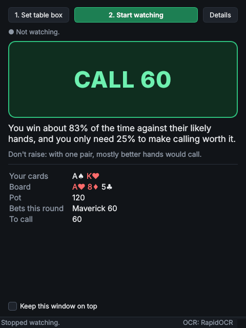
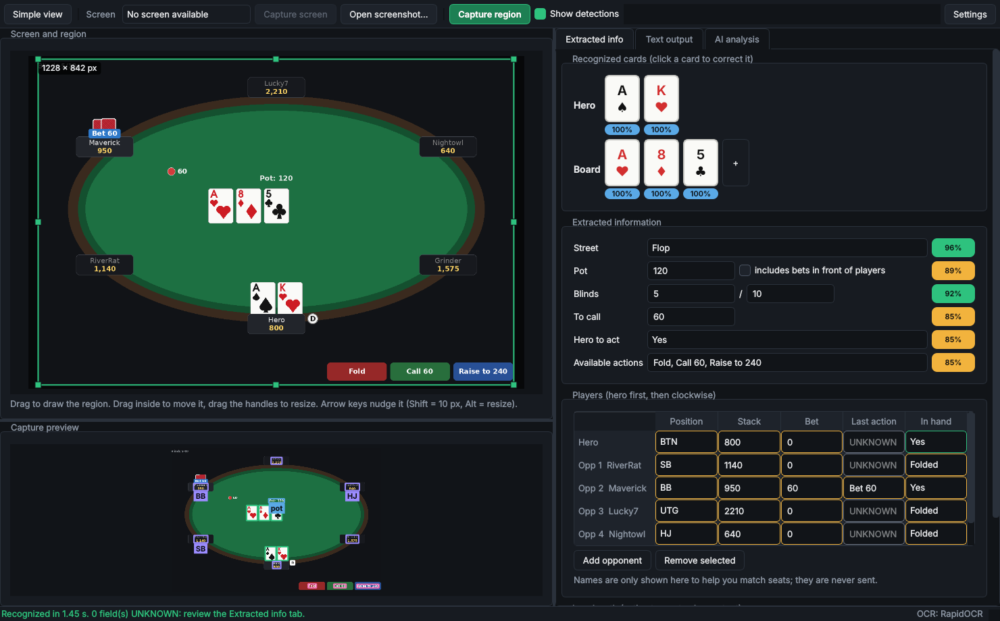

# PokerScribe

PokerScribe reads a poker table from your screen and turns it into clean, structured text. All image recognition happens locally on your Mac. If you choose an AI provider, the only thing it ever receives is that text: no screenshots, no player names, no site or app names, nothing about your computer.

Built for practice with simulators, reviewing recorded sessions, and platforms that allow AI assistance. Most real-money poker sites prohibit real-time assistance software during play, so check a site's rules before using it there.

## Quick start: just tell me what to do



1. **Set table box.** PokerScribe grabs your screen and you drag a box around the poker table (felt, cards, players and the Fold/Call/Raise buttons). The box is remembered.
2. **Start watching.** It looks at the table about two and a half times a second and reads it again whenever anything changes, even a single digit of a stack, as soon as the cards and chips stop moving (usually well under a second). No screenshots to take. It knows when it's still the same hand: cards it has read stay known for the rest of the hand, new board cards are added as they come, and a new hand starts only on clear signs (new hole cards, a new board, the pot starting over, or the stacks showing a new hand began). The line under the buttons shows which hand it's on.
3. **Do what the big word says.** FOLD (red), CHECK (blue), CALL (green), BET, RAISE or ALL IN (amber), always with the amount, and one sentence saying why. WAIT (grey) means it's not your turn. A yellow message (CONFIRM YOUR CARDS, CONFIRM THE BOARD) is not a poker move: something couldn't be read and it wants you to confirm it. It never guesses.

**Let Claude read cards it isn't sure of (optional, in Settings).** Instead of asking you, PokerScribe sends Claude a small cropped picture of just the unclear cards (nothing else from the screen: no names, amounts, buttons or site) and fills them in from Claude's answer, usually within a second or two. A card the app and Claude read the same way is learned, so it's read exactly next time and Claude isn't needed for it again. It needs a Claude API key, sends at most four small pictures per hand, and is the only picture the app ever sends; the AI analysis stays text only.

**Read now.** The button next to Start watching reads the table right away, even if nothing seems to have changed.

**Never a wrong kind of move.** It never says FOLD when checking is free (when it can't tell, it says CHECK OR FOLD), never mistakes your own raise for someone raising you (it says WAIT until someone acts), and trusts the Check and Call buttons on screen over its own chip maths. Your hand is judged against what the board already gives everyone: a pair, straight or flush lying in the middle is shared, and the instruction says so. A simulator (`tools/simulate.py`) plays thousands of hands against different kinds of opponents and flags any of these.

**All in only when it makes sense.** It goes all in only when your own stack is short or the bet would be most of your stack anyway, and only when your stack was read reliably (while watching, when the chips that left the stacks add up to the pot). A short-stacked opponent never makes it shove your whole stack.

**Exact cards (on by default).** The first time PokerScribe sees a card shape it isn't sure of, it shows its reading and asks "Are these cards right?". Click **Yes, all right**, or click a card to change it. From then on that shape is matched exactly against what you confirmed. A card is reported without asking only when it matches a shape it knows closely (and clearly better than any other card), or when the general reader is very sure and agrees; anything else is asked, never assumed. It works across several poker sites at once: each site's card shapes are learned the first time they come up, and kept side by side. The 247 Free Poker deck is built in, so its cards are read exactly from the first hand.

Tips:

- Keep the poker window visible, side by side with PokerScribe. It reads what is on screen inside the box, so the table can't be covered, minimized or on another desktop. A second monitor works too.
- Turn on **Keep this window on top** so the instruction stays visible while you click in the poker window.
- If you move or resize the poker window, press **Set table box** again.
- **Details** shows everything that was read, lets you correct it, and has the text for the AI.

**Other players' bets.** Some clients (247 Free Poker, for example) never print bet amounts. While watching, PokerScribe works them out from each player's stack: where the hand began is found from the numbers themselves (the last set of stacks from which the chips that left add up exactly to the pot), so a missed moment or a pause to confirm cards doesn't throw it off. That gives every player's bet this round, the amount to call and what you have already put in. On clients that print bets in front of the players and add them to the pot only at the end of a round, the printed bets are used and checked the same way. It only uses these numbers when they add up; otherwise the instruction tells you the most you should call ("CALL UP TO 12"). It needs to see one hand start, so if you start watching in the middle of a hand, bets are known from the next one.

<br clear="right">

## What it does



1. **Capture.** Pick a display, grab it, then drag a box around the table. Drag inside the box to move it, drag the handles to resize it, or nudge it with the arrow keys (Shift = 10 px, Alt = resize). After that, **Capture region** (Cmd+R) grabs just that area whenever you want a fresh read. You can also open a saved screenshot or a frame from a recording.
2. **Recognize (locally).** Hero cards, board, street, pot, blinds, stacks, current bets, positions (from the dealer button), last actions, which players are still in the hand, whether it is the hero's turn, and the available action buttons. Every value carries a confidence score. Anything below the threshold becomes **UNKNOWN**: the best guess is shown to you, but it is never sent.
3. **Correct.** Click any card or field to fix it. Card corrections also teach the recognizer your deck, so the next reads of that deck are exact.
4. **Local math.** Hand description, draws, pot odds, equity against random hands and against a range you choose, EV of calling, chance to improve, stack-to-pot ratio, and a call-or-fold verdict (see "About optimal play" below).
5. **Text output.** The exact text that would be sent, in a fixed, machine-readable format, checked by a privacy filter before anything can leave the computer.
6. **AI analysis (optional).** Claude, any OpenAI-compatible API, or a free local model through Ollama or LM Studio. Nothing is sent until you press **Analyze with AI**.

Example output for the demo table:

```
GAME: Texas Hold'em
HERO CARDS: Ace of Spades, King of Hearts
HERO POSITION: Button
STREET: Flop
BOARD: Ace of Hearts, 8 of Diamonds, 5 of Clubs
POT: 120
POT INCLUDES CURRENT BETS: No
BLINDS: 5/10
HERO STACK: 800
HERO BET: 0
ACTIVE PLAYERS: 2
OPPONENT 1:
  Position: Big Blind
  Stack: 950
  Bet: 60
  Last action: Bet 60
  Status: In hand
FOLDED OPPONENTS: 4 (Small Blind, Under the Gun, Hijack, Cutoff)
HERO TO ACT: Yes
AVAILABLE ACTIONS: Fold, Call 60, Raise to 240
ACTION FACING HERO: Call 60, raise, or fold
TO CALL: 60
LOCAL MATH (estimates from a local calculator, not solver output):
  Hero hand: Pair of Aces
  Pot odds: call 60 to win 180, needs 25.0% equity
  Equity vs random hands (1 opponent): 86.3% (+/- 0.3%)
  Equity vs Medium range, top 25% (1 opponent): 83.2% (+/- 0.3%)
  EV of calling, ignoring future betting: +139.7
  Call or fold: call by pot odds only (future betting not modelled)
  Chance to improve: next card 23.4% (11 outs), by the river 45.9%
  Stack to pot ratio: 4.4
UNKNOWN FIELDS: None
```

Internally the state is JSON (every value with its confidence and source); the **Text output** tab shows both, and you can copy or save the JSON.

## Install on macOS

1. You need Python 3.10 to 3.14 (3.15 is too new for the text reader's installer). If you don't have one, install Python 3.14 from [python.org](https://www.python.org/downloads/) or with Homebrew: `brew install python@3.14`.
2. Unzip PokerScribe, open Terminal in that folder and run:
   ```
   ./setup_mac.sh
   ```
   This creates a private environment in `.venv` and installs everything (about 750 MB, mostly Qt and OpenCV).
3. Start the app with `./run_mac.sh`, or double-click **PokerScribe.command** in Finder (the first time, right-click it and choose Open).
4. **Screen Recording permission.** The first capture asks macOS for permission. Turn it on in System Settings > Privacy & Security > Screen & System Audio Recording for the app you launched from (Terminal, iTerm, ...), then quit and reopen PokerScribe. Without it, macOS returns screenshots where other apps' windows are blank.

## Try it without a poker client

```
./run_mac.sh --image app/assets/demo/demo_flop.png
```

Press **Capture region**. The Extracted info tab fills in and the Text output tab shows the text above. A second demo, `demo_preflop_9max.png`, shows a 9-handed preflop spot where it is not the hero's turn.

## Using the Details view

Press **Details** in the simple view (and **Simple view** to go back).

1. Put the poker window where you can see it (a second display is easiest; otherwise turn on "Hide this window while capturing" in Settings).
2. Choose the display and press **Capture screen**.
3. Drag a box around the whole table, including the action buttons at the bottom. The box is remembered between sessions.
4. Press **Capture region** (Cmd+R) whenever you want a read. Check the coloured badges: green is confident, amber is usable, grey means UNKNOWN. Fix anything that is wrong; your edits show as "manual".
5. Pick the opponent range for the local math (Medium by default) or type a custom range such as `22+, A2s+, KTs+, QJs, AJo+, KQo`.
6. Open **Text output** to see exactly what would be sent, then **AI analysis** to ask for an analysis.

For best card recognition, keep "Capture at full Retina resolution" on (Settings > Capture and math) and correct the first few cards from a new deck design; after that the app knows that deck.

## AI providers

All providers receive only the structured text and the fixed instructions in `app/ai/prompt.py`.

**Claude.** Settings > AI provider > Claude, paste your API key and press **Save key**. The key is stored in the macOS Keychain (or set the `ANTHROPIC_API_KEY` environment variable instead). The default model, `claude-haiku-5-5`, is the cheapest; one analysis sends roughly 600 tokens and gets back up to the "max answer length" you set. Asking again about an identical spot is answered from a cache at no cost.

**Free and fully local.** Install [Ollama](https://ollama.com), run `ollama pull llama3.1`, then choose OpenAI-compatible with address `http://localhost:11434/v1` and model `llama3.1`. Nothing leaves the computer at all.

**Others.** Any OpenAI-compatible service (OpenAI, OpenRouter, LM Studio) works the same way. To add a different kind of provider, subclass `AIProvider` in `app/ai/base.py` and register it in `app/ai/registry.py`.

**None.** The default. The app builds the text and sends nothing; you can copy the text anywhere you like.

## Privacy, in detail

- **Screenshots stay in memory.** They are never written to disk unless you save one yourself, and never sent anywhere.
- **Recognition is local.** OpenCV, RapidOCR's bundled models, Apple Vision and Tesseract all run on your machine. A test runs capture, recognition, math and text generation with networking disabled.
- **The text is built only from fixed vocabulary and numbers.** Card names, positions, actions and statuses come from enumerations; no free text read from the screen (player names, table titles, logos) is ever rendered.
- **A privacy check runs before every request.** The outgoing text must match the expected line structure and use only the app's vocabulary. A URL, path, e-mail address, unknown word or unexpected character blocks the request. Tests try player names, site names, URLs, file paths and e-mail addresses.
- **Minimal requests.** The app uses its own small HTTP client instead of vendor SDKs, which add headers describing your operating system, CPU and Python version. Requests carry only content type, accept, a generic user agent and the provider's authorization header; the body holds the model name, the instructions and the text. Tests check the exact headers and body against a local mock server.
- **API keys** live in the Keychain or environment variables, never in the code or in `settings.json`.
- **Network use.** The only connection the app makes is the AI request you trigger.

## How recognition works

Existing card models were investigated first. The public 52-class detectors (for example YOLO models trained on the Augmented Startups playing-card dataset) are trained on photos of physical cards and need PyTorch or large ONNX files, a poor fit for crisp, rendered card faces. PokerScribe instead:

- finds card faces with OpenCV (bright, low-saturation, card-shaped regions), separates overlapping hole cards, and extracts the corner rank and suit;
- matches them against templates rendered from about 25 fonts, combined with shape cues (row and column profiles, solidity, where a suit is widest, how convex its top is) and ink colour (two- and four-colour decks);
- adds templates learned from your corrections, which are matched first; with Exact cards on, only a close match to a shape you confirmed (and well ahead of every other card) counts as known. 6, 8 and 9, which template matching mixes up most, are also told apart by their closed counters (an 8 has two, a 6 one low down, a 9 one high up), and a suit is judged on both the corner symbol and the big one in the middle;
- ships the card shapes of one real client (247 Free Poker), cut from its own screenshots at many sizes (`tools/build_deck.py`). They are used only with Exact cards on, and only count when a card matches them closely, so other sites' cards aren't pulled towards them;
- takes the blinds only from a line that says what they are ("Blinds", "NL Hold'em", a currency sign) or from the chips the two blinds put in at the start of a hand. A bare "11/26" or "3/5" on screen is a date or a count, not the blinds; when the text and the chips disagree, the chips win; and bigger blinds than the last hands' are only believed once seen in two hands, so a misread can never make you look short-stacked;
- reads text with RapidOCR by default (Apple Vision and Tesseract are options), then infers the layout from conventions shared by almost every client: a row of three to five board cards, the hero's cards nearest the bottom, nameplates with the stack below the name, bets between a seat and the centre, a round "D" dealer button, and a row of action buttons at the bottom. No site-specific coordinates are used.

## Accuracy so far

Measured on synthetic tables whose card fonts were deliberately excluded from the templates:

- **Cards** (`python tools/eval_cards.py 300`, 1,500 cards at 36 to 120 px tall, with blur and JPEG artefacts): 98.6% found. Best guess correct for 97 to 99% of cards at 90 to 120 px and about 91% at 56 to 70 px; tiny cards (36 to 44 px) mostly come back UNKNOWN by design. Of the cards shown as known, 0.6% were wrong (5 of 893, mostly 44 px cards). After teaching a deck from 13 corrected cards, the tests read that deck exactly.
- **Exact cards** (tested end to end in `app/tests/test_ui_flow.py`, plus a benchmark on six unseen decks at 56 to 120 px with blur and JPEG): after one confirmation per rank and per suit, 1,739 cards were reported as known and **none were wrong**; the remaining 23% were asked about (and learned) instead. On a real client, which draws each card identically every time, the confirmed shapes match at about 0.9 to 1.0 similarity and different ranks at 0.6 or less.
- **Fanned hole cards** (turned 8 to 20 degrees and overlapping, like many clients draw them): each card's tilt is measured from its corner index and the card is read straightened, three times; a read counts only when two agree. In the synthetic test about 60% are read and none are read wrong; the rest come back UNKNOWN. Cards from a real client's fanned hand read correctly at 98 to 100% confidence.
- **A real client** (two 247 Free Poker tables, each read 25 times at 55 to 100% of the original size, some with blur or JPEG artefacts, 50 reads in all): stacks 99.6% right and none wrong (the other 0.4% stayed UNKNOWN for that read), pot 100%, every position 100%, whose turn and the action buttons 100%. Cards in Exact cards mode: none wrong. Every amount is read twice, the second time zoomed in on just that spot, and it is only used when the reads agree; numbers that should carry a "$" but lost it (a classic "$998" read as "5998") are re-read.
- **Built-in 247 deck** (real 247 Free Poker boards and hands from 10 screenshots the deck was not built from, read at 55 to 160% of the original size): at 85 to 115% (the size of a normal browser window) 97% of cards were read exactly from the first hand without asking, and 90% over all sizes; **none were wrong**. The rest are asked once. A full hand (preflop to river) read end to end: every card, pot, stack and bet right on every street. On other card styles it adds no wrong reads: 0 wrong out of 800 cards from six unseen decks before teaching, 0 of 2,250 after teaching, and 0 of 2,250 with only half of a deck taught (the state a new site is in while it learns).
- **Whole tables**: 6- and 9-handed, preflop to river, overlapping hole cards, four-colour decks, scaled and JPEG-compressed images, plus checks that unreadable cards and an erased pot become UNKNOWN rather than invented.

Real clients will differ from synthetic tables. Review the values for your first sessions and correct the cards; that is also what teaches the recognizer your deck.

## How the instruction is decided

- **Calling a bet** is maths: your chance of winning against the opponents' likely hands compared with the price (pot odds). With a big draw and deep stacks it allows a slightly worse price, because hitting can win more later.
- **Before the flop** it follows standard position-based ranges: the share of hands worth opening grows from about 10 to 15% in early position to about 45% on the button. It re-raises the strongest hands, calls a raise with good ones (wider from the big blind, which gets a better price), raises over players who just called the blind, and goes all in or folds when short-stacked. Calling an all-in is maths against the hands people usually go all in with, tighter the deeper the shove.
- **After the flop** it bets strong hands for value (about two thirds of the pot), semi-bluffs big draws heads-up (about half the pot), and checks the rest. It raises a bet only with two pair or better that uses your cards (three of a kind or better on the river); one pair calls, because mostly better hands would call a raise.
- A **close call** is marked as such: both choices are worth about the same.

That is solid, standard poker, close to how a good regular plays, and it never makes a call the maths says loses money against the assumed range. It is not a game-theory solver: it doesn't bluff in spots a pro might, its bet sizes are standard rather than tuned, and it assumes typical opponents. Single hands are still decided by the cards.

## About optimal play

No app can promise optimal play in every spot. Bet sizing, bluffing and multi-street strategy come from game-theory solvers, and PokerScribe does not include one. The AI analysis is reasoning, not a solver, and it can be wrong.

What is exact is the call-or-fold decision when calling ends the betting (heads-up on the river, or an all-in). There the verdict compares EV(call) = equity x (pot + call) - call with folding, against the range you selected, using exact enumeration on the river and turn. Elsewhere the verdict is labelled "pot odds only" because future betting is not modelled.

`tools/eval_decisions.py` tests this. It plays random heads-up spots where calling ends the betting, lets the app decide with its normal time budget, and compares against the true best decision from exact enumeration (river, turn, flop) or a 400,000-hand simulation (preflop). Latest run:

| Street | Spots | Wrong decisions | Too close to call | EV lost |
|---|---|---|---|---|
| River | 150 | 0 | 0 | 0% |
| Turn | 150 | 0 | 1 | 0.001% |
| Flop | 40 | 0 | 0 | 0% |
| Preflop | 40 | 0 | 1 | 0.001% |

"EV lost" is the share of the chips at stake given up compared with perfect decisions, counting every "too close to call" spot as a mistake. The worst single spot gave up 0.8% of the chips at stake in that hand. These figures are only as good as the range you pick: the verdict is the best response to that range, not to the opponent's real cards.

## Research and the strategy roadmap

Strategy work follows a written plan with measured gates, kept in `docs/research/` so it never depends on one chat: the research report (where strength is lost, eight research directions, a roadmap toward a Pluribus-style agent), the frozen baseline agent, a log of every experiment with its result and standard error, the dataset report, and the book and paper principles with their status in the engine. A change replaces the baseline only after beating it by at least 2.5 standard errors in paired simulation, without losing to any opponent type. All testing stays offline or on tables you're allowed to use; PokerScribe never plays for you.

## Project structure

```
app/
  main.py            entry point
  capture/           screens, screen grabbing (mss), screenshot files, macOS permission check
  vision/            card detection and classification, glyph templates, OCR engines
  recognition/       amount parsing, generic layout analysis, image -> GameState,
                     hand tracker (bets from stack changes while watching)
  state/             JSON game state, positions, text output, privacy check
  poker/             hand evaluation (treys), ranges, equity, pot odds, call-or-fold,
                     advice (the one instruction in the simple view)
  ai/                provider interface, Claude, OpenAI-compatible, minimal HTTP client
  config/            settings file, API keys (Keychain / environment)
  ui/                PySide6 interface
  tests/             test suite and the synthetic table renderer
tools/               benchmarks, template builders, the simulator and paired comparisons
  phh/               hand history dataset pipeline (separate from the app, see tools/phh/README.md)
docs/research/       research report link, frozen baseline, experiment log, dataset report, book and paper notes
```

## Tests

```
.venv/bin/python -m pip install -r requirements-dev.txt
.venv/bin/python -m pytest
```

The suite covers region selection, capture coordinates, card recognition, OCR, layout analysis on whole tables, learning from corrections, the text format, the privacy check, local maths, the advice in many preflop and postflop spots, the hand tracker, the decision benchmark, the AI providers against a mock server, and full runs through the real window in both views, including watch mode.

## Troubleshooting

- **Screenshots are blank or show only the desktop:** Screen Recording permission (see Install, step 4).
- **"CAN'T SEE THE TABLE" or cards stay UNKNOWN:** press Set table box again and include whole cards. Keep full Retina capture on, and correct a few cards (Details) so the app learns the deck.
- **"PokerScribe is covering part of the table box":** move the PokerScribe window beside the table; it would otherwise read itself.
- **Amounts or positions are wrong:** try another OCR engine in Settings. Positions depend on finding the dealer button.
- **"No Claude API key":** Settings > AI provider > Claude > Save key.

## Known limitations

- Card faces must be light (white or cream). Decks with dark or fully coloured faces are not detected.
- The hero's seat is assumed to be at the bottom of the table, as in most clients.
- Seats are found as a name with a stack amount directly above or below it; unusual layouts may need manual correction.
- Side pots are not modelled; opponent ranges are simple presets or a range you type.
- The Apple Vision OCR option was built against the ocrmac library and tested with a stand-in, but not on a real Mac in the build environment. RapidOCR, the default, is fully tested.
